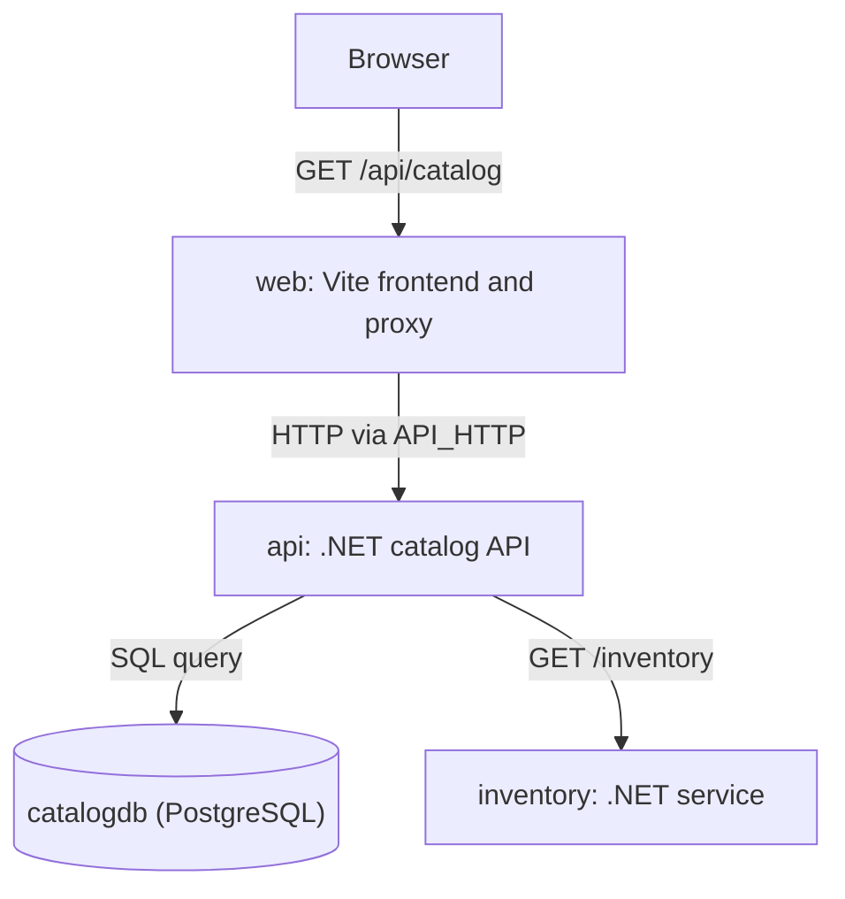

# 2. Model the whole app

Complete the prerequisites and one-time secret setup in the
[sample README](../../README.md).

This walkthrough targets Aspire CLI, AppHost SDK, and stable integrations
**13.6.4**.

Start the catalog if it is not already running:

```bash
apphost=catalog/Catalog.AppHost/Catalog.AppHost.csproj
aspire start --apphost "$apphost" --isolated
```

In the dashboard, wait for **web** to become **Healthy**, open its HTTP endpoint,
and click **Load catalog**. The optional CLI checks below automate those actions;
they are not prerequisites for starting the app.

## See the request path



Arrows show request traffic, not startup order. The API queries `catalogdb`, hosted
by the `postgres` resource, before calling inventory. The AppHost supplies
configuration and readiness relationships; it is not an HTTP hop in this path.

Inspect [`AppHost.cs`](../../catalog/Catalog.AppHost/AppHost.cs), then open the
dashboard's resource graph. Trace three independent concerns:

| Concern | Actual sample code | What it does not imply |
| --- | --- | --- |
| Configuration | API references to `catalogdb` and `inventory`; `web.WithReference(api)` | Does not wait for startup or instrument a client |
| Readiness | `.WaitFor(catalogdb)`, `.WaitFor(inventory)`, `.WaitFor(api)`, and real `/health` probes | Does not guarantee every later business request succeeds |
| Telemetry | [`ServiceDefaults`](../../catalog/ServiceDefaults/Extensions.cs), `Aspire.Npgsql`, ASP.NET Core and HTTP instrumentation | Not automatically added to every language merely by hosting it |

`api` waits for an actual, healthy `catalogdb`, not just a running server process.
It creates and seeds `catalog_items` before it accepts traffic; its database health
check participates in `/health`. Vite has an explicit `/health` middleware, not
a catch-all HTML page mistaken for a readiness probe.

The AppHost keeps region and state-volume settings in a separate block. These
belong to the [configuration/state walkthrough](../05-portable-state-and-config/),
but the shared API still requires them at startup; do not remove them from the
runnable companion just because the article's focused excerpt omits them.

## Follow the .NET client

The named inventory client in
[`Catalog.Api/Program.cs`](../../catalog/Catalog.Api/Program.cs) calls
`GetAsync("/inventory")`, so it needs `BaseAddress = new Uri("http://inventory")`.
This is a logical service address, not a fixed host or port.
Service Defaults registers the HTTP service-discovery handler, which resolves
the endpoint supplied by `.WithReference(inventory)`. A reference alone does not
set the HTTP client's base address.

## Follow the frontend route

The AppHost's `.WithReference(api)` supplies `API_HTTP` to `web`. The Vite config
uses that value **on the Node server** as the `/api` proxy target. The browser
only calls `/api/catalog` and `/api/state`.
The dashboard's **web > Load catalog** action also uses the web endpoint and
returns the HTTP status, trace ID, and JSON response; it does not bypass Vite.

The full AppHost's `PublishAsStaticWebsite("/api", api, ...)` also establishes the
backend reference. The explicit `WithReference(api)` makes the development
dependency visible without relying on that publish helper; neither call creates
the Vite development proxy itself.

Compare the current API URL with the `API_HTTP` environment entry for **web**
in the dashboard. Do not copy secrets or the entire environment into a report.
Raw `describe --format Json` can expose the password embedded in the API's
`ConnectionStrings__catalogdb` and `CATALOGDB_URI`; parameter redaction does not
make those fields safe. Use the table inventory in the optional CLI checks instead.
In the browser's Network panel, a catalog request goes to the **web origin**, not
a hard-coded API port. Find the returned trace ID in the dashboard.

Verify the API server span, exactly one HTTP client span to inventory, its
inventory server child, and the PostgreSQL query. Vite does not emit application
spans in this sample. Follow [Walkthrough 01](../01-keep-the-failing-run/) to pin
the run and retain the diagnostic evidence.

Now run the [503 walkthrough](../01-keep-the-failing-run/). Its unchanged green health
checks prove why configuration, readiness, and successful requests are different
claims.

Java/Rust preview integrations and Project V2 are optional article comparisons,
not prerequisites or unimplemented required resources in this app.

## Optional CLI verification

Use these checks for a repeatable, non-interactive run after starting the AppHost:

```bash
aspire wait catalogdb --apphost "$apphost" --status healthy --timeout 120 --non-interactive
aspire wait api --apphost "$apphost" --status healthy --timeout 120 --non-interactive
aspire wait web --apphost "$apphost" --status healthy --timeout 120 --non-interactive
aspire resource web load-catalog --apphost "$apphost" --non-interactive
aspire describe --apphost "$apphost" --format Table --non-interactive
```

Set `trace_id` to the ID returned by **Load catalog** before querying spans:

```bash
: "${trace_id:?Set trace_id to the trace ID returned by Load catalog}" && \
  aspire otel spans --trace-id "$trace_id" --apphost "$apphost" --format Json --non-interactive
```

The fail-fast proxy tests do not require running services:

```bash
node --test tests/scripts.test.mjs
```
